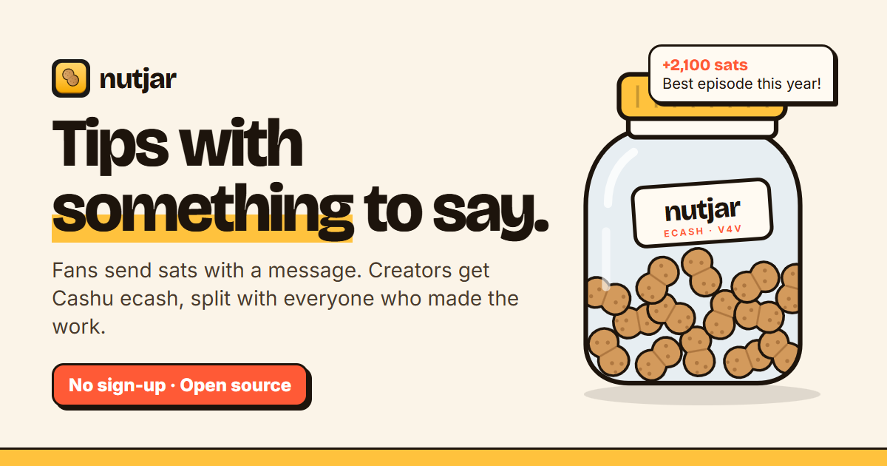

# 🥜 Nutjar

**A tip jar for creators, paid in Cashu ecash.** Any fan can boost a creator, especially a podcaster, with sats and a message, from the Lightning wallet they already use. The boost is split fairly between everyone who made the work. There's nothing for the fan to sign up for and nothing for the creator to run.

Built for [Nut November](https://nutnovember.org), **Value4Value track**. **Live: https://nutjar.vercel.app**



## Try it in 60 seconds

1. **Boost someone (fake sats, no wallet needed).** Open https://nutjar.vercel.app and use the live demo. It runs on the testnut mint and the invoice pays itself. Turn on the sound 🔊, hold ▶ on the NUTJAR BOY game pad, press ⚡, and watch the boost land, split between two demo creators, in their inbox right next to it.
2. **Make a boost link.** https://nutjar.vercel.app/b/ → paste an npub or a Lightning address → you get a short link like `nutjar.vercel.app/you@getalby.com` (or `/npub1…`), with a QR code. Pick the game pad style if you like.
3. **Be the creator.** https://nutjar.vercel.app/inbox.html → sign in with Amber (Android), nsec.app or a browser extension. Nutjar never sees your key. Set up receiving once, then read boosts, collect them into your jar, and move them to any Cashu wallet or a Lightning address.

## The problem

- Tipping a creator usually means an account on someone's platform.
- Receiving Lightning needs a node, or a company holding your money and staying online for you.
- Splitting tips between hosts, guests and editors is done by hand, or not at all.
- Small tips get eaten by fees, and tips arrive without words.

## Why Cashu: Lightning is the door, Cashu is the house

Most fans already have a Lightning wallet, so Nutjar takes Lightning in. Once the payment is in, it becomes Cashu ecash, and that's where the useful part happens:

| Cashu makes this possible | How |
|---|---|
| **Creators get paid while offline** | The boost is ecash P2PK-locked to the creator's key (NUT-11) and waits on Nostr as a nutzap (NIP-61). Nobody has to be online to receive it. |
| **One payment, split fairly** | One fan payment becomes separately locked shares for host, guest and editor, following the show's Podcasting 2.0 `podcast:value` splits. No per-recipient Lightning payments. |
| **The message travels with the money** | The nutzap event carries the ecash and the fan's words together. |
| **Small tips survive** | Ecash moves for free. Fees only apply when entering or leaving through Lightning. |
| **Your balance follows you** | Collected ecash is saved NIP-44-encrypted on Nostr (NIP-60), so it shows up on any device you sign in on. No account anywhere. |
| **Fans can skip Lightning entirely** | Anyone holding Cashu taps *Pay with ecash instead*. |

So every boost through the main route mints new ecash and puts it to real use, and creators who have never held ecash end up holding it. Creators without Nostr can still use a plain Lightning address: the fan's payment becomes ecash for a moment and is paid straight out to them, an easy way in.

**Hopp / Nodesignal:** the track sponsor's [Hopp](https://gitlab.com/nodesignal/hopp) player plans Cashu support as NIP-61 nutzaps (ADR 0005), which is exactly what Nutjar sends. A Hopp listener could boost with Nutjar today, and a future Hopp Cashu wallet could read these boosts directly.

## It works with real money

- **Nov 17:** a 100-sat boost paid from a real wallet arrived as a nutzap on the Minibits mint, was collected in the creator app (Amber signer) and moved into Minibits. The same day the whole flow was repeated on one Android phone, no laptop: boost, collect, and "Open in wallet app" straight into Minibits.
- **Nov 18, first outside user:** someone saw the build log on X and made his own boost link with only a Wallet of Satoshi address. A 1,000-sat boost paid from Minibits became ecash and was paid out to his Lightning address with the message attached; 990 sats arrived and the 8 left over came back to the fan as ecash.
- `npm run e2e`: 40 end-to-end checks against the testnut mint (below).
- Beta safety cap: 100,000 sats per boost.

## Add it to a site

```html
<script src="https://nutjar.vercel.app/nutjar.js" defer></script>
<cashu-boost npub="npub1…" lnaddress="you@getalby.com" label="Episode 42"></cashu-boost>
```

Works on any page: the widget lives in shadow DOM, so your theme's CSS can't break it. If your site sends a strict Content-Security-Policy, allow `script-src https://nutjar.vercel.app` and `connect-src https: wss:` (the widget talks to the Cashu mint, Nostr relays and Lightning address servers straight from the fan's browser). No inline styles needed. With `feed="…"`, feeds whose host blocks cross-site reads are fetched through a small relay on nutjar.vercel.app (`/api/feed`, RSS only).

No site? Use a boost link: `https://nutjar.vercel.app/<npub or Lightning address>`, add `?skin=gamepad` for the game pad.

## What's in the box

| Page | What it does |
|---|---|
| `index.html` | Landing page with a **two-sided live demo**: boost on the NUTJAR BOY game pad (sound, hold-to-charge, keyboard), watch two demo creators' inbox receive and collect it. Runs on the testnut mint (fake sats, self-paying invoices). |
| `b/` | **Boost links.** A creator's page from just an npub or a Lightning address, with their Nostr name and picture, classic or game pad style. Short form `/<npub>` or `/<address>` on Vercel. With no creator it's the link maker (QR code, share on X). |
| `embed.html` | **Embed builder**. Enter an npub/lightning address, or load your RSS feed and pick an episode. Live preview, copy the code. |
| `inbox.html` | **Creator app** (installable PWA). Sign in with Amber or nsec.app over Nostr Connect (NIP-46) or a NIP-07 extension. Set up receiving (NIP-60 key + NIP-61 profile), read boosts as a message feed, collect them into your jar (balance saved on Nostr, NIP-60), move ecash to any Cashu wallet (open-in-wallet link or QR) or cash out to a Lightning address. |
| `nutjar.js` | The widget: one script, a `<cashu-boost>` web component in shadow DOM. Works on any page. |

## How a boost flows

1. **Resolve recipients.** From `recipients`, `feed` + `episode`, `npub`/`lnaddress`, or a NUT-18 `payment-request`. For each recipient the widget looks for a nutzap profile (kind `10019`): directly via npub, or by following their lightning address's NIP-05 to a nostr key.
2. **Fund.** The listener pays a Lightning invoice from a mint quote (NUT-04), or pastes a Cashu token that is swapped into fresh proofs right away so it can't be double-spent mid-boost.
3. **Split.** Largest-remainder integer split by `split` weight. `fee="true"` recipients take their percentage off the top. Keysend-only recipients can't be paid by a mint, so they're shown as skipped and their share is spread over the rest.
4. **Deliver each share** by the best rail available:
   - **Nutzap.** Ecash P2PK-locked to the recipient's key (sender prepays the redemption fee, so they net exactly what the widget showed), published as kind `9321` with the message as content and NIP-73 `i` tags (`podcast:item:guid:…`, `podcast:guid:…`).
   - **Lightning.** Melt (NUT-05) to the recipient's lightning address, message as a LUD-12 comment.
   - **NUT-18.** POST the payload to the payment request's endpoint.
5. **Leftovers** (rounding, fee change) are handed back to the listener as a token. Anything in flight is checkpointed to `localStorage`, so a closed tab never silently loses sats ("Get them back" banner).

## Widget attributes

| Attribute | Meaning |
|---|---|
| `npub` | Creator's nostr key. Boosts become nutzaps if they publish a kind 10019 profile. |
| `lnaddress` | Lightning address fallback (also used to discover an npub via NIP-05). |
| `recipients` | JSON array: `[{"name","split","npub"?,"lnaddress"?,"type"?,"address"?,"fee"?}]`. Podcasting 2.0 `valueRecipient`s map 1:1. |
| `feed`, `episode` | Read splits from an RSS feed at runtime (needs CORS on the feed). The embed builder bakes them into `recipients` instead. |
| `podcast-guid` | Feed GUID for the NIP-73 tag. |
| `payment-request` | A NUT-18 `creqA…` with an HTTP POST transport. |
| `mint` | Mint to fund Lightning payments at. Default: first mint the main recipient accepts, else Minibits. |
| `label`, `name` | What's being boosted / who. |
| `amounts` | Up to 4 preset amounts, e.g. `21,100,500,2100`. |
| `theme` | `light`, `dark`, or omit for auto. |
| `relays` | Comma-separated relay list. |
| CSS | `--cb-accent`, `--cb-bg`, `--cb-ink`, … and `::part(card)`. |

The element fires a `boost` event (`detail: { amount, results }`) when done.

## Standards used

Cashu NUT-00/03/04/05/07/10/11/12/18 · Nostr NIP-05, NIP-07, NIP-44, NIP-46 (remote signers), NIP-60 (wallet key, token and history events), NIP-61 (nutzaps), NIP-73 (podcast identifiers) · LUD-06/12/16 · Podcasting 2.0 `podcast:value`.

## Develop

```bash
npm install
npm run dev        # site with hot reload
npm run build      # site + standalone dist/nutjar.js
npm run e2e        # end-to-end tests against testnut.cashu.space
npm run typecheck
```

`npm run e2e` mints real test ecash, splits a boost 60/40 to two nutzap recipients with a keysend recipient skipped, checks the events (kind, tags, signatures, P2PK locks), proves a stranger can't redeem them and each recipient can, then pays a lightning-address recipient through a local mock LNURL server and checks the invoice was paid and the comment arrived.

## Security notes

- The widget is non-custodial static code. Ecash exists in the listener's browser only between funding and delivery, and is checkpointed to `localStorage` during that time.
- **Mints are trusted** for the sats they back. Creators choose which mints they accept. Listeners paying by Lightning fund at the embed's mint.
- Nutzaps are **public** on relays: amount, message, episode and time are visible (the sender is an ephemeral key unless they opt to sign with their own). Hopp's ADR 0014 prefers NUT-18 for private streaming for this reason; the widget supports both.
- The creator app never asks for an nsec. Signing happens in the creator's own signer (Amber, nsec.app, a browser extension). The receiving key is stored NIP-44-encrypted to the creator (NIP-60), and only their signer can decrypt it.
- This is hackathon software. Use small amounts.

## Built in November

Everything in this repository was written during Nut November 2026 (started 12 Nov 2026). See the git history.

## License

MIT

Sound effects on the NUTJAR BOY game pad are from [Kenney.nl](https://kenney.nl) (Casino Audio and Interface Sounds), released under CC0. Licence files are in `src/site/sfx/`.
